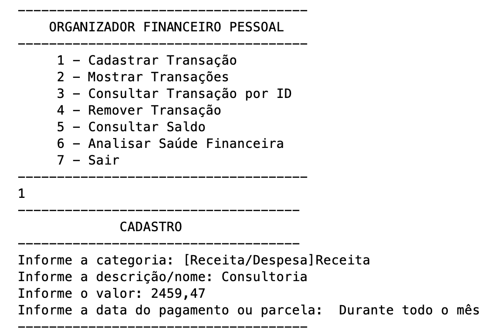
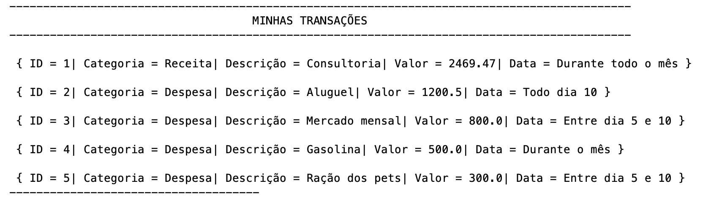
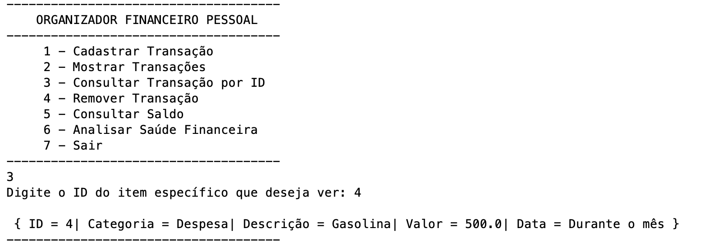
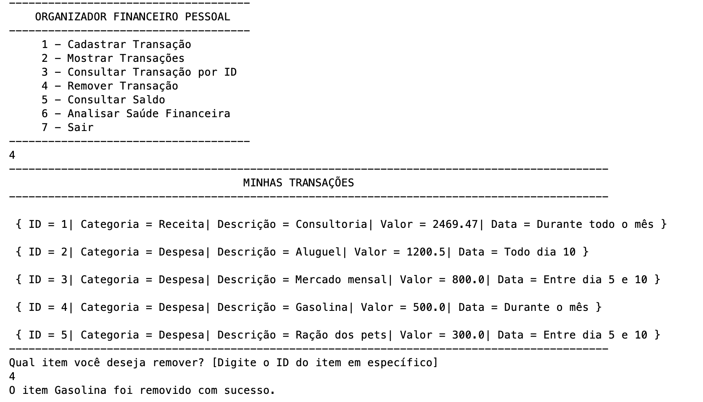
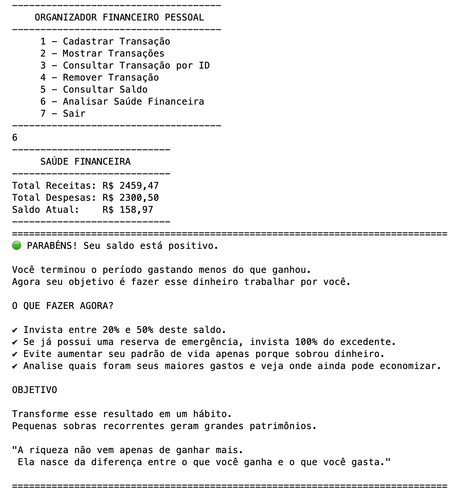
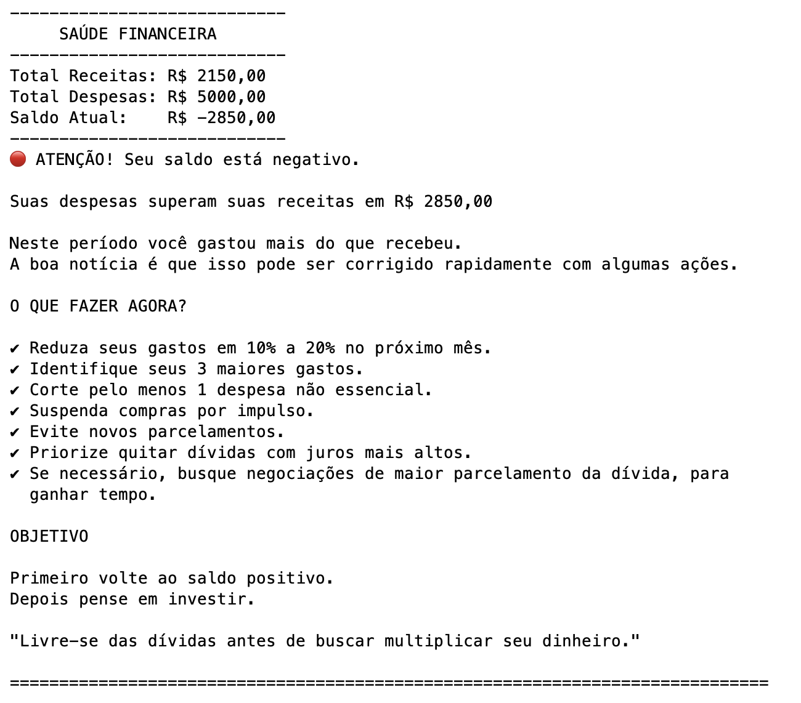
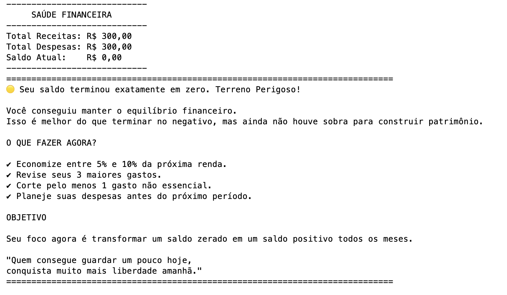

# 💰 Personal Finance Organizer

Sistema de gerenciamento financeiro pessoal desenvolvido em Java.

O projeto foi criado para resolver uma necessidade real de organização financeira e, ao mesmo tempo, servir como minha principal aplicação de evolução técnica durante a formação em Desenvolvimento Backend.

Ao invés de desenvolver diversos projetos isolados, optei por evoluir continuamente um único sistema, incorporando novas tecnologias conforme avanço nos estudos.

---

# 📸 Demonstração

## Menu Principal


## Cadastro de Transação



## Listagem de Transações



## Consulta por ID



## Remoção de Transação



## Consulta de Saldo


## Análise da Saúde Financeira

### Saldo Positivo



### Saldo Negativo



### Saldo Zerado



---

# ✨ Funcionalidades

- Cadastro de receitas e despesas
- Listagem de transações
- Consulta de transações por ID
- Remoção de transações
- Cálculo automático do saldo
- Análise personalizada da saúde financeira

---

# 🏛️ Estrutura do Projeto

```
src/
└── personalfinanceorganizer/
    ├── PersonalFinanceOrganizer.java
    ├── RepositorioTransacao.java
    ├── ServicoTransacao.java
    └── Transacao.java
```

### Responsabilidade de cada classe

| Classe | Responsabilidade |
|---------|------------------|
| `PersonalFinanceOrganizer` | Interface de interação com o usuário e menu principal |
| `ServicoTransacao` | Contém as regras de negócio da aplicação |
| `RepositorioTransacao` | Gerencia o armazenamento e manipulação das transações |
| `Transacao` | Representa o modelo de uma transação financeira |

---

# 🛠️ Tecnologias

- Java
- Programação Orientada a Objetos (POO)
- Git
- GitHub

---

# 📚 Conceitos praticados

Durante o desenvolvimento deste projeto foram aplicados conceitos como:

- Encapsulamento
- Organização em camadas
- Separação de responsabilidades
- Estruturação de aplicações Java
- Regras de negócio
- Refatoração contínua

---

# 🚀 Roadmap

Este projeto continuará evoluindo conforme minha evolução como desenvolvedor.

## ✅ Versão Atual

- Java Console
- CRUD completo
- Arquitetura em camadas
- Análise da saúde financeira

## 🔄 Próxima etapa

- Migração de arrays para ArrayList
- Collections

## ⏳ Futuras versões

- Persistência com JDBC
- Banco de Dados SQL
- Spring Boot
- API REST
- Spring Data JPA
- Testes automatizados

---

# ▶️ Como executar

Clone o repositório

```bash
git clone https://github.com/lucasemanueldp/personal-finance-organizer.git
```

Abra o projeto no NetBeans ou IntelliJ IDEA.

Execute a classe:

```
PersonalFinanceOrganizer.java
```

---

# 👨‍💻 Autor

**Lucas Emanuel**

Estudante de Análise e Desenvolvimento de Sistemas, com foco em Desenvolvimento Backend Java.

Atualmente construindo uma base sólida através da evolução contínua deste projeto.