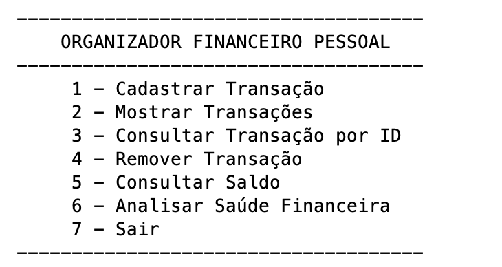
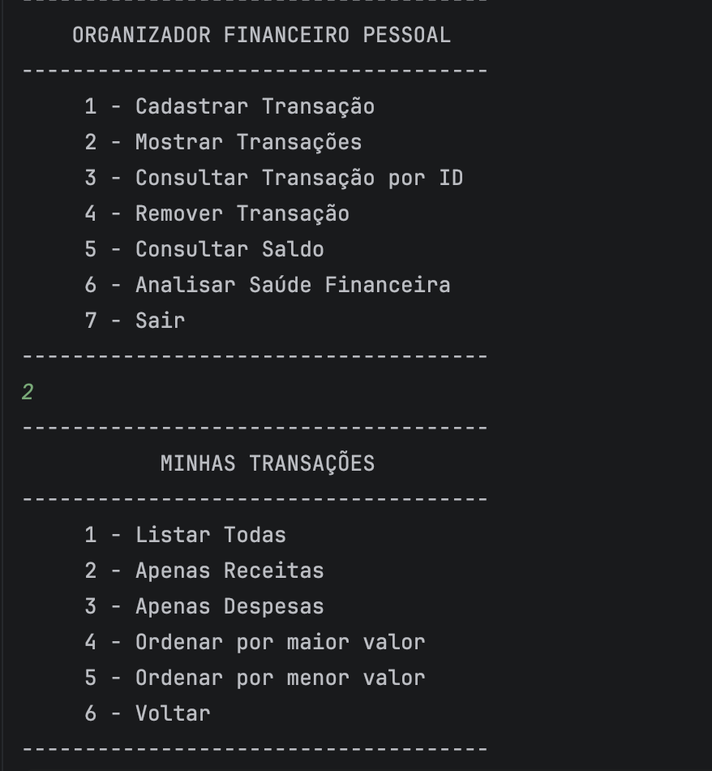
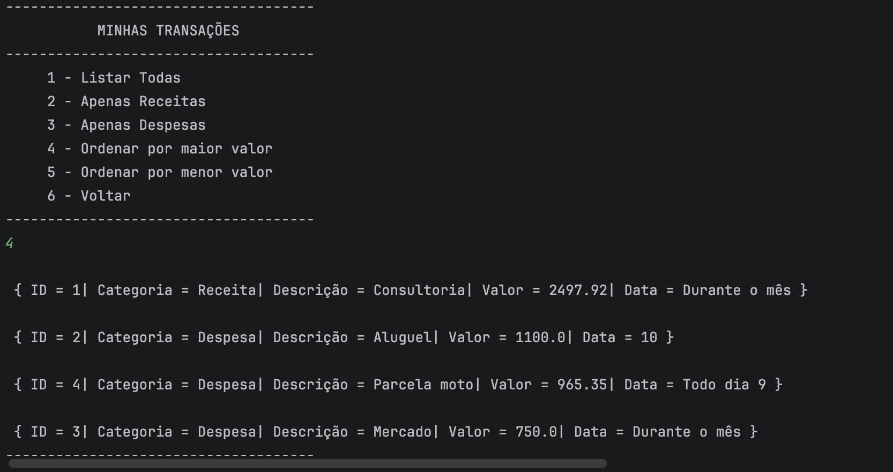
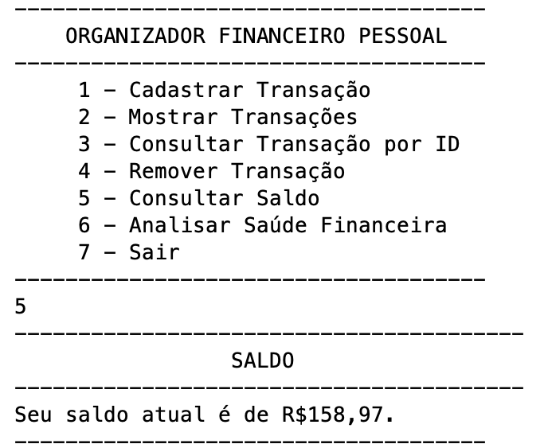

# 💰 Personal Finance Organizer

Sistema de gerenciamento financeiro pessoal desenvolvido em Java.

O projeto foi criado para resolver uma necessidade real de organização financeira e, ao mesmo tempo, servir como minha principal aplicação de evolução técnica durante a formação em Desenvolvimento Backend.

Em vez de desenvolver diversos projetos isolados, optei por evoluir continuamente um único sistema, incorporando novas tecnologias conforme avanço nos estudos.

---

# 📸 Demonstração

## Menu Principal



## Cadastro de Transação


## Listagem de Transações


## Submenu de Listagem



## Ordenação por Maior Valor



## Consulta por ID


## Remoção de Transação


## Consulta de Saldo



## Análise da Saúde Financeira

### Saldo Positivo


### Saldo Negativo


### Saldo Zerado


---

# ✨ Funcionalidades

- Cadastro de receitas e despesas com validação de dados
- Listagem de transações com filtros (todas, apenas receitas, apenas despesas)
- Ordenação por maior e menor valor
- Consulta de transações por ID
- Remoção de transações
- Cálculo automático do saldo
- Análise personalizada da saúde financeira
- Entrada de dados protegida contra erros de digitação

---

# 🏛️ Estrutura do Projeto

```
src/
└── personalfinanceorganizer/
    ├── PersonalFinanceOrganizer.java
    ├── RepositorioTransacao.java
    ├── ServicoTransacao.java
    ├── Transacao.java
    └── TransacaoNaoEncontradaException.java
```

### Responsabilidade de cada classe

| Classe | Responsabilidade |
|---------|------------------|
| `PersonalFinanceOrganizer` | Interface de interação com o usuário, menus e leitura de dados |
| `ServicoTransacao` | Contém as regras de negócio e as validações da aplicação |
| `RepositorioTransacao` | Gerencia o armazenamento e a manipulação das transações |
| `Transacao` | Representa o modelo de uma transação financeira |
| `TransacaoNaoEncontradaException` | Exceção personalizada lançada ao tentar remover uma transação inexistente |

---

# 🛠️ Tecnologias

- Java
- Collections (ArrayList, List)
- Streams e expressões lambda
- Comparator
- Tratamento de exceções
- Git e GitHub

---

# 📚 Conceitos praticados

Durante o desenvolvimento deste projeto foram aplicados conceitos como:

- Encapsulamento
- Organização em camadas
- Separação de responsabilidades
- Regras de negócio
- Validação de dados na camada de serviço
- Tratamento de exceções (nativas e personalizadas)
- Programação funcional com Streams (filter, sorted, toList)
- Refatoração contínua

---

# 🚀 Roadmap

Este projeto continuará evoluindo conforme minha evolução como desenvolvedor.

## ✅ Versão atual (v0.4.0)

- Aplicação Java de console
- Arquitetura em camadas (modelo, repositório, serviço, interface)
- Listagem com filtros e ordenação usando Streams
- Validação de dados e tratamento de exceções

## 🔄 Próxima etapa (v0.5.0)

- Persistência em banco de dados PostgreSQL com JDBC
- Testes automatizados com JUnit
- Gerenciamento de dependências com Maven

## ⏳ Futuras versões

- API REST com Spring Boot
- Spring Data JPA
- Interface web consumindo a API

---

# ▶️ Como executar

Clone o repositório

```bash
git clone https://github.com/lucasemanueldp/personal-finance-organizer.git
```

Abra o projeto no IntelliJ IDEA.

Execute a classe:

```
PersonalFinanceOrganizer.java
```

---

# 👨‍💻 Autor

**Lucas Emanuel**

Estudante de Análise e Desenvolvimento de Sistemas, com foco em Desenvolvimento Backend Java.

Atualmente construindo uma base sólida através da evolução contínua deste projeto.